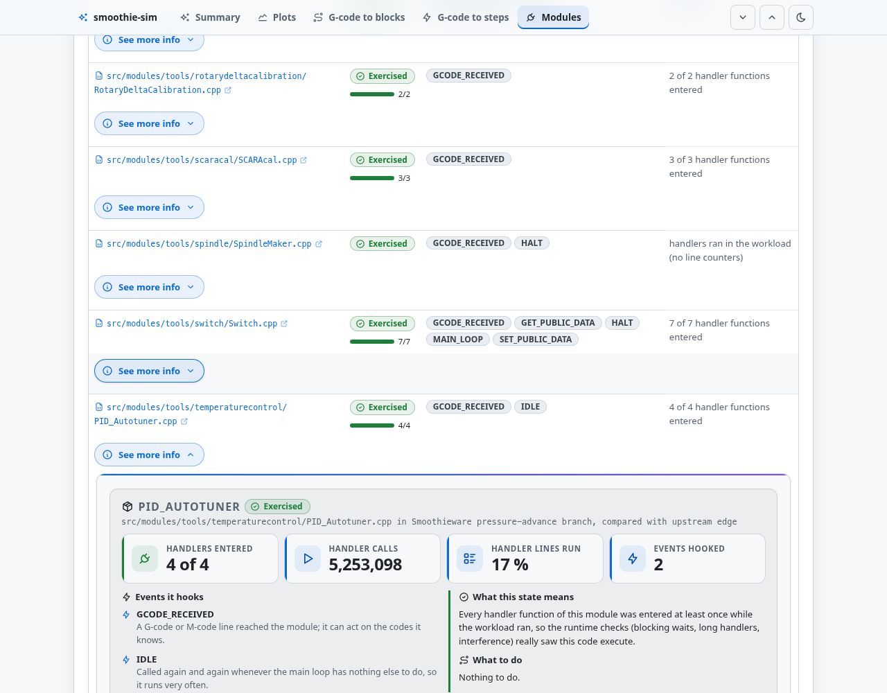

<p align="center"><picture><source media="(prefers-color-scheme: dark)" srcset="assets/logo-dark.svg"></picture></p>
<h1 align="center">smoothie-sim</h1>
<p align="center"><strong>Reviewing a Smoothieware pull request and no board on the bench?</strong><br>Run the real firmware core on your PC and let the checkers find bad planning, blocking waits and memory growth.</p>
<p align="center"><sub>Linux · C++ · Python · GPL-2.0+</sub></p>
<p align="center"><a href="#quick-start">Quick start</a> · <a href="#see-it-in-action">Example report</a> · <a href="#what-smoothie-sim-does">What it checks</a> · <a href="#command-line">Commands</a> · <a href="#limits">Limits</a> · <a href="documentation/README.md">Full documentation</a></p>

> This README is the short version. The [full documentation](documentation/README.md) covers every checker, option and file.

smoothie-sim copies a [Smoothieware](https://github.com/Smoothieware/Smoothieware) checkout to a build folder, lays host shims over it and compiles the real Kernel, Robot, Planner, Conveyor, StepTicker, G-code dispatch and modules for the PC. The firmware tree is never modified. Checkers then run G-code through it and judge what comes out.

**Status:** works on Linux against Smoothieware `edge`; it is a self-contained simulator; CI and pull-request gating live in the separate smoothie-gate project. No hardware, network or account is needed except for the optional old-PR replay, which calls the GitHub API through `gh`.

## Quick start

Install a [release](https://github.com/Smoothieware/smoothie-sim/releases) with `curl -fsSL https://github.com/Smoothieware/smoothie-sim/releases/latest/download/install.sh | sh` (also a `.deb`, an `.rpm` and a container image: [Installation](documentation/installation.md)) and run `smoothie-sim build && smoothie-sim check`. Or work from a checkout:

You need `g++` (with its `gcov`), `make`, `python3` (standard library only) and `git` on Linux; [one-line install commands for nine distributions](#install-the-dependencies). The first `make` downloads the `edge` branch of [Smoothieware](https://github.com/Smoothieware/Smoothieware) into `fw/` (a shallow `git clone`), builds the simulator in `build/`, and needs no root. `run_checks.sh` with no arguments checks that firmware and writes results to `out/`.

```sh
make -j"$(nproc)"
./run_checks.sh
```

Success looks like a `report.html` and a `summary.md` in `out/`; open `report.html` in a browser. The script exits non-zero if a checker fails; warnings do not fail it.

To check your own firmware tree or a pull request, pass `SMOOTHIE_SRC=<path>` to `make`. Against a PR, give `run_checks.sh` the base firmware tree as its third argument: only blocking calls new compared with it fail. To add the RAM and flash comparison, append the base and PR firmware ELF files (built with `gcc-arm-none-eabi`):

```sh
./run_checks.sh build/pr/smoothie-sim $PWD/fw $PWD/base out/pr base.elf pr.elf
```

More: [Getting started](documentation/getting-started.md) · [How it works](documentation/how-it-works.md)

### Install the dependencies

One line per distribution; each installs everything the build and the checks need (`g++` with its `gcov`, `make`, `python3`, `git`, `curl`, `tar`, CA certificates). Only Ubuntu 24.04 is tested by the project; the other names follow each distribution's package naming.

| Distribution | Command |
| --- | --- |
| Debian, Ubuntu, Linux Mint | `sudo apt-get update && sudo apt-get install -y g++ make python3 git curl tar ca-certificates` |
| Fedora | `sudo dnf install -y gcc-c++ make python3 git curl tar ca-certificates` |
| RHEL, Rocky, AlmaLinux, CentOS Stream | `sudo dnf install -y gcc-c++ make python3 git curl tar ca-certificates` |
| openSUSE Leap, Tumbleweed | `sudo zypper install -y gcc-c++ make python3 git curl tar ca-certificates` |
| Arch, Manjaro | `sudo pacman -S --needed gcc make python git curl tar ca-certificates` |
| Alpine | `sudo apk add g++ make python3 git curl tar ca-certificates bash` |
| Void | `sudo xbps-install -S gcc make python3 git curl tar ca-certificates` |
| Gentoo | `sudo emerge --ask sys-devel/gcc dev-build/make dev-lang/python dev-vcs/git net-misc/curl app-arch/tar app-misc/ca-certificates` |
| NixOS, Nix on any OS | `nix-shell -p gcc gnumake python3 git curl gnutar cacert` |

Optional, only for the RAM and flash comparison: Debian and Ubuntu `sudo apt-get install -y binutils-arm-none-eabi`, Fedora `sudo dnf install -y arm-none-eabi-binutils-cs`, Arch `sudo pacman -S --needed arm-none-eabi-binutils`, anywhere else the [Arm GNU Toolchain](https://developer.arm.com/downloads/-/arm-gnu-toolchain-downloads). Optional, only for the old-PR replay (`tools/`): the GitHub CLI `gh` (logged in) and `patch`; Debian and Ubuntu `sudo apt-get install -y gh patch`, Fedora `sudo dnf install -y gh patch`, Arch `sudo pacman -S --needed github-cli patch`.

Assumptions that are easy to miss:

- **GCC, not Clang.** The build uses GCC-only flags and the coverage step runs `gcov --json-format`, which needs GCC 9 or newer and a `gcov` of the same version as `g++` (with several GCCs installed, set `CXX=g++-13` and put `gcov-13` first on `PATH`). The simulator is built as a native 64-bit binary; Linux is the only tested platform and macOS is not supported.
- **GNU userland.** The scripts use `nproc`, `readlink -f`, `sha256sum` and GNU `find`, `sed` and `tar`; on BSD or macOS they fail.
- **bash.** `run_checks.sh`, `tools/*.sh` and the `smoothie-sim` wrapper need bash (`#!/usr/bin/env bash`); minimal images such as Alpine do not ship it, which is why it is in the Alpine line above. Python 3 runs without extra packages, but the checkers were only tried with Python 3.11, so expect a recent one is needed.
- **Network at first build.** `make` clones Smoothieware `edge` from GitHub into `fw/` unless you pass `SMOOTHIE_SRC=<tree>`; behind a proxy or offline, clone the firmware yourself first.

## See it in action

<p align="center"><a href="https://smoothie-sim-example.pages.dev/report.html"></a></p>

[Open the live example report](https://smoothie-sim-example.pages.dev/report.html), generated from the Smoothieware `pressure-advance` branch compared with `edge`; findings `edge` already has are collapsed. The report shows the per-checker results, the toolpath, the speed profile rebuilt from the planned blocks, and steps per block. `summary.md` and `comment.md` are written for a GitHub job summary and a pull request comment.

## What smoothie-sim does

- **Plan**: feed G-code through the serial path and check the planner blocks: step conservation, end position, speed and acceleration limits, junction continuity. [Checkers](documentation/checkers.md)
- **Step**: inject planned blocks into the real StepTicker and check per-axis step counts, block durations and rates. [Checkers](documentation/checkers.md)
- **Block**: find `wait`, `wait_us`, `safe_delay*` and busy loops, statically and while a workload runs the modules; fail on handlers that run too long; verify modules do not change motion. [Wait rules](documentation/wait-rules.md)
- **Measure**: compare flash and RAM of a candidate ELF with a reference, with the symbols that grew. [Checkers](documentation/checkers.md)

Also included:

- [Old-PR replay](documentation/pr-replay.md): rebuilds historical PRs rejected for blocking waits and fails if the checker stops flagging one.
- [Race mode](documentation/race-mode.md): lets the step interrupt preempt the firmware in the middle of a flag write.
- Feature checkers for filament advance and backlash compensation, for firmware trees that have them.

## Command line

| Command | What it does |
| --- | --- |
| `make [SMOOTHIE_SRC=<fw>] [BUILD=<dir>]` | Build `<dir>/smoothie-sim` (default `build/`) from `<fw>` (default: `edge`, cloned into `fw/`). Options: `COVERAGE`, `RACE`, `AXIS`, `NOFLAGS`, `EXTRA_FILES`. |
| `./run_checks.sh [<sim> [<fw> [<base\|-> [<out> [ref.elf cand.elf]]]]]` | Run the checkers and write the report. All arguments default to what `make` builds. |
| `checkers/<name>.py --help` | Run one checker on its own. |
| `tools/regress_prs.py <out> --firmware <fw>` | Replay the historical PR regression test (needs `gh`). |

Every option: [Getting started](documentation/getting-started.md) and [Checkers](documentation/checkers.md).

## Limits

Step timing is simulated at a 10 us tick and is approximate; SD, USB, network, laser, panel and spindle hardware are not simulated. Full list: [Limits](documentation/limits.md).

## Project, help, and licence

Report problems in this repository's issue tracker. Include the Smoothieware revision, the exact command and its output, with private content removed from logs. For any command, `checkers/<name>.py --help` and [Getting started](documentation/getting-started.md) list the options. Contributing: [CONTRIBUTING.md](CONTRIBUTING.md). Changes: [CHANGELOG.md](CHANGELOG.md).

smoothie-sim is licensed under the [GNU GPL version 2 or later](LICENSE). The files in [`overlay/`](overlay/LICENSE-NOTE.md) are adapted from Smoothieware and stay under its GPL version 3 or later; a built simulator contains both, so it is distributed under GPL version 3 or later. The same applies to the files adapted from the Carvera Firmware Simulator (GPL version 3 or later, see Acknowledgements).

## Acknowledgements

Parts of smoothie-sim are adapted from, or inspired by, the [Carvera Firmware Simulator](https://github.com/f355/carvera_firmware_simulator) by Konstantin Tcepliaev (GPL version 3 or later). Where their code is used, the file keeps their copyright header, and the combined work is GPL version 3 or later. Full list: [Acknowledgements](documentation/acknowledgements.md).

- RAM model: heap and AHB pool replay on the LPC1768 layout, with ARM class sizes from DWARF (`checkers/memory_check.py`, `checkers/lpc_dwarf.py`, `tools/lpc_memory_layout.py`, `sim/sim_alloc.cpp`).
- Event-ordered timer dispatch: the design studied from their `timer_scheduler`, `interrupt_controller`, `event_engine` and `virtual_clock` (our own implementation in `sim/sim_main.cpp`).
